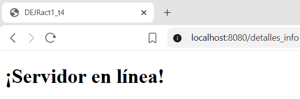
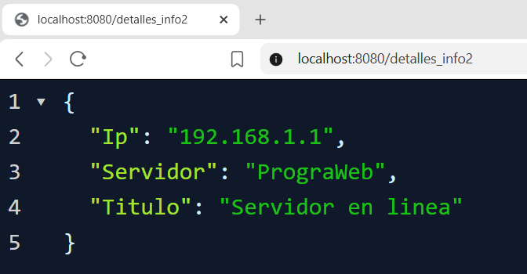
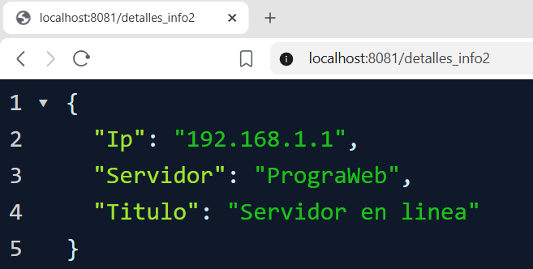
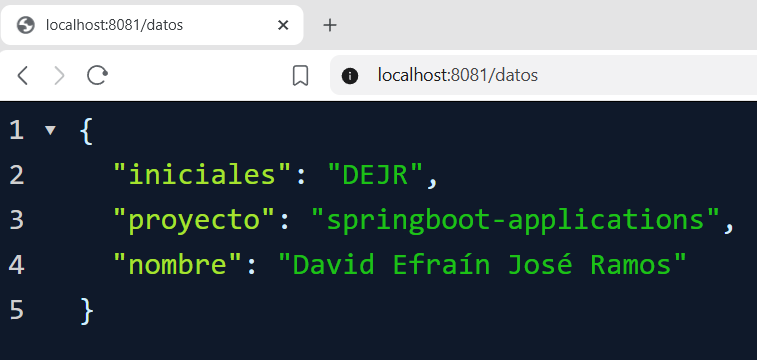
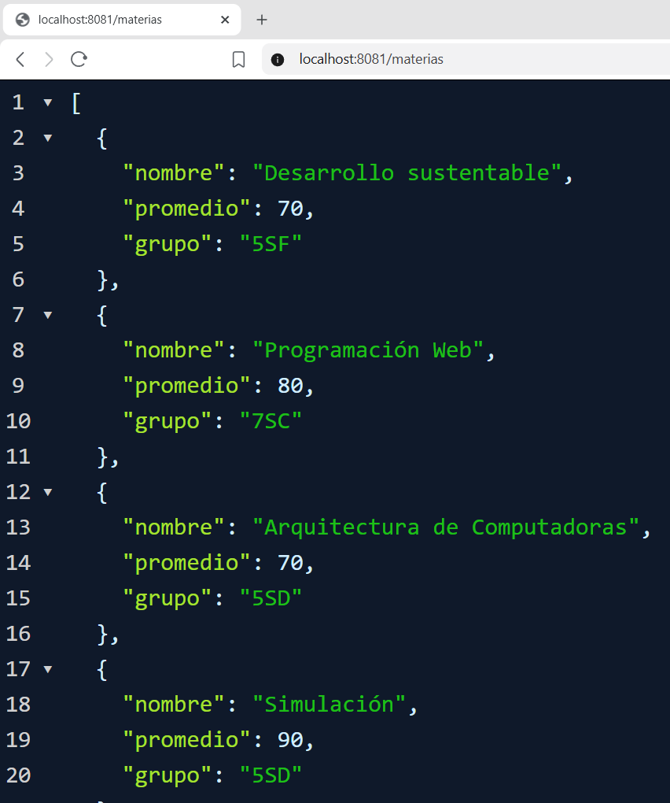
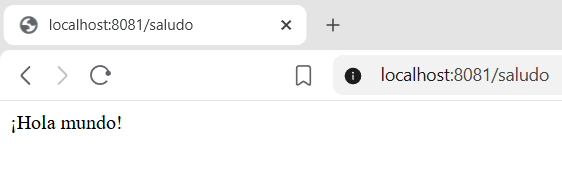

# 2. Act2. Spring MVC
## Comprender el patrón MVC en Spring Boot usando Thymeleaf para renderizar vistas del lado del servidor, estructurar datos con clases DTO, manejar parámetros de distintas formas (@RequestParam, @PathVariable, @ModelAttribute), configurar valores externos con @value, y probar peticiones POST con Postman.
***
#### Elaborado por: David Efraín José Ramos NL 19
***
### Preguntas de la fase tres:
##### a) ¿Qué es el patrón MVC y cómo se ve reflejado en tu proyecto (qué parte es el Modelo, cuál la Vista y cuál el Controlador)?
El patrón MVC o Modelo Vista controlador es una propuesta de arquitectura del software utilizada para separar el código por sus distintas responsabilidades, manteniendo distintas capas que se encargan de hacer una tarea muy concreta, lo que ofrece beneficios diversos.

Como su nombre lo indica esta se divide en tres componentes distintos:

1. Modelo (datos): El trabajo del modelo es simplemente administrar los datos. Ya sea que los datos provengan de una base de datos, una API o un objeto JSON, el modelo es responsable de administrarlos.
2. Vista (UI): El trabajo de la vista es decidir qué verá el usuario en su pantalla y cómo.
3. Controlador (Cerebro): La responsabilidad del controlador es extraer, modificar y proporcionar datos al usuario. Esencialmente, el controlador es el enlace entre  y el modelo.

En mi proyecto se ve así:

```java
@Controller //<- Controlador (Cerebro)
public class EjemploController {

    @GetMapping("/detalles_info")

    public String info(Map<String, Object> modelo){ // <- Modelo(datos)
        modelo.put("Titulo", "Servidor en linea");
        modelo.put("Servidor", "PrograWeb");
        modelo.put("Ip", "192.168.1.1");
        return "detalles_info"; //<- Vista (UI)

    }
```


##### b) ¿Para qué sirve una clase DTO y por qué no simplemente usar la entidad directamente en la vista o en la petición?
En primer lugar la clase DTO(Data Transfer Object) o objeto de transferencia de datos es una clase diseñada para transferir datos entre diferentes capas de una aplicación. Por ejemplo, la capa de controlador y la capa de servicio. 

La clase DTO contiene como una lógica de negocio y su propósito Es actuar como un contenedor para nuestros datos. 

Esta clase se usa para la separación de preocupaciones. Una preocupación hablando de servidores con tecnología Spring es una funcionalidad, una
característica o una especie de requisito que se debe implementar en una aplicación. Por ejemplo, el manejo de la lógica de un negocio en un proyecto, el manejo de persistencia de datos ó cuando validamos datos en Spring.

Las DTO sirven para reducir datos expuestos, nos ayudan a mejorar la seguridad y el tamaño de una carga.

Las diferencias entre una DTO y una entidad. 

-> DTO
En una DTO  yo puedo transferir datos entre capas. 
-> Entidad
Con una entidad yo solo puedo representar una tabla en una base de datos.
-> DTO
Las DTO yo puedo usarlas para temas relacionados con la interfaz de usuario o de una Api.
-> Entidad
Con las entidades yo solo las uso para persistencias en la base de datos.
-> DTO
Las DTO no tienen relaciones complejas.
-> Entidad
Las entidades se pueden incluir relaciones entre entidades porque esto es más orientado al tema de relación de bases de datos relacionales. 
-> DTO
Las DTO yo no tengo esa situación de manejar relaciones entre entidades.
-> DTO
Las clases de DTO no dependen del JPA (Java Persistence Api) a nivel de framework.
-> Entidad
Las entidades incluyen a anotaciones de JPA (Java Persistence Api) como el @entity.

###### c) ¿Qué puerto usaste en tu VPS y por qué tuviste que definirlo manualmente en vez de dejar el que viene por defecto?
En el local use el puerto 8080, pero supongo que en VPS se tiene que cambiar porque vamos a crear diversos proyectos. En el video tuvieron un problema al correr su programa porque el puerto '8080' estaba ocupado. Es facil cambiarlo desde 'aplication.properties'.

Ejemplo: 

```java 
    server.port = 8080
```
En mi puerto use el 8081 y lo tuve que definir manualmente desde 'aplication.properties' porque mi compañero usara el 8082, ya que el 8080 suele usarse por defecto en pruebas locales.

##### d) Pega el enlace de tu repositorio de GitHub, y el link de tu proyecto ya corriendo en el VPS.

Link de repositorio: https://github.com/David-Ramos1010/DEJRact1_t4

Links del VPS:
http://194.163.143.215:8081/detalles_info2
http://194.163.143.215:8081/datos
http://194.163.143.215:8081/materias
http://194.163.143.215:8081/saludo

### Imagenes:

***

***
#### /detalles_info2

#### /datos

#### /materias

#### /saludo

#### Elaborado por: David Efraín José Ramos NL 19